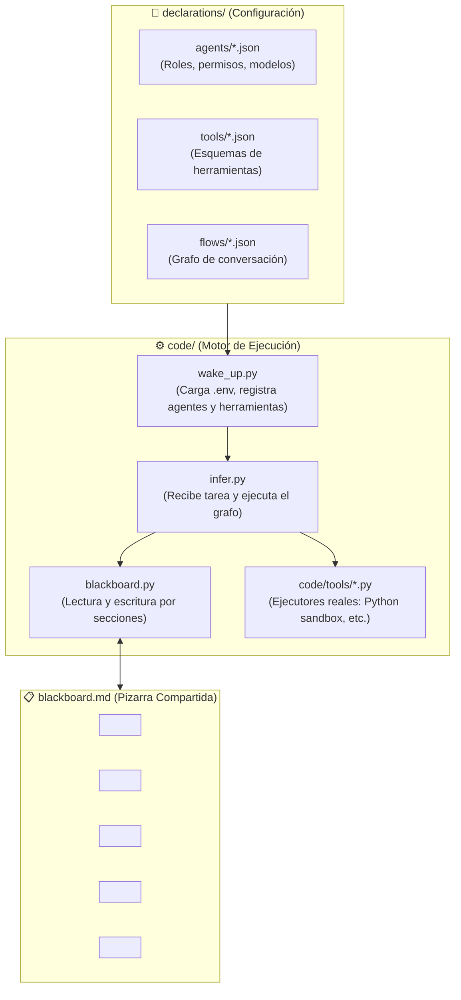

# 🚀 Task-Driven ML Harness

Un entorno de ejecución (*harness*) y orquestación multi-agente impulsado por IA, diseñado y optimizado específicamente para **resolver problemas de Machine Learning de forma autónoma**.

---

## 💡 Filosofía y Principios de Diseño

1. **Orientado a Machine Learning, no a Chat Humano:**
   El objetivo del sistema no es mantener una conversación interactiva con un usuario, sino ejecutar rigurosamente las etapas de un proyecto de ciencia de datos: auditoría de datos, ingeniería de variables, experimentación de modelos y selección objetiva basada en métricas.

2. **Patrón Pizarra (Blackboard Pattern) en Markdown (`blackboard.md`):**
   En lugar de propagar un historial largo y desordenado de mensajes entre agentes (lo cual satura el contexto y produce el efecto "teléfono roto"), los agentes comparten una **pizarra central en Markdown**.
   - Los agentes leen el contexto previo acumulado.
   - Cada especialista ejecuta sus herramientas y **escribe sus hallazgos, métricas y código en su sección correspondiente**.
   - Los agentes no borran el trabajo previo; la información se va acumulando de forma estructurada.

3. **Flujo de Conversación como un Grafo Declarativo:**
   La interacción entre agentes no es caótica ni emergente; está gobernada por un **grafo de flujo** (`declarations/flows/*.json`) que define formalmente la secuencia de turnos, las transiciones y las dependencias de información.

4. **Separación Total entre Declaración y Código:**
   - **`declarations/`**: Contiene la definición de agentes, herramientas y flujos en archivos `.json`. Modificar un comportamiento o crear un nuevo flujo no requiere alterar el código del motor.
   - **`code/`**: Implementa la lógica operativa (gestión de la pizarra, sandbox de ejecución, arranque y orquestación).

5. **Agente Consolidador / Decisor Final:**
   El nodo terminal del grafo es un agente con rol de *Lead Data Scientist*. Su función es de **solo lectura**: inspecciona toda la evidencia registrada en la pizarra, audita la consistencia de los experimentos, evita sobreajustes (*overfitting*) y formula la **decisión final** (el mejor pipeline, código reproducible y reporte explicativo).

---

## 🏛️ Arquitectura del Sistema



---

## 📁 Estructura del Repositorio

```text
task-driven-harness/
├── declarations/                    # Capa declarativa (JSONs)
│   ├── agents/                      # Declaración de agentes (rol, modelo, permisos)
│   ├── tools/                       # Esquemas y firmas de las herramientas
│   └── flows/                       # Grafos del flujo de conversación entre agentes
├── code/                            # Capa de código ejecutable
│   ├── tools/                       # Implementación de las herramientas en Python
│   ├── blackboard.py                # Gestor de lectura/escritura sobre blackboard.md
│   ├── wake_up.py                   # Carga de entorno, validación y arranque del pool de agentes
│   └── infer.py                     # Punto de entrada que recibe la tarea y corre el grafo
├── artifacts/                       # Salida de artefactos (modelos guardados, datasets, scripts)
├── blackboard.md                    # La pizarra compartida en Markdown
├── .env.example                     # Plantilla de variables de entorno (API keys, timeouts)
├── .env                             # Archivo local de variables de entorno (ignorado en git)
├── .gitignore                       # Exclusiones de Git
├── requirements.txt                 # Dependencias del proyecto
└── README.md                        # Documentación arquitectónica
```

---

## 🔄 Ciclo de Vida de Ejecución

1. **Configuración de Credenciales (`.env`):**
   Se configuran las claves de API necesarias (Gemini, OpenAI, Anthropic) y los parámetros del sandbox (timeouts, límites de memoria).

2. **Arranque del Sistema (`wake_up.py`):**
   - Lee `.env` y las carpetas de `declarations/`.
   - Valida que cada herramienta declarada tenga su función correspondiente en `code/tools/`.
   - Inicializa el pool de agentes asignándoles sus *system prompts*, herramientas y permisos de lectura/escritura sobre la pizarra.

3. **Inferencia y Ejecución del Grafo (`infer.py`):**
   - Recibe la especificación del problema (ej. ruta del dataset, columna objetivo, métrica de evaluación).
   - Escribe la sección inicial `problem_spec` en `blackboard.md`.
   - Activa el grafo de flujo seleccionado (`declarations/flows/*.json`).
   - Cada agente toma su turno:
     1. Lee el estado relevante de `blackboard.md`.
     2. Ejecuta sus herramientas asignadas (ej. inspeccionar datos, ejecutar código Python en sandbox, calcular métricas).
     3. Escribe sus conclusiones o resultados en su sección de la pizarra.
     4. Pasa el control al siguiente agente según las aristas del grafo.
   - El **Agente Consolidador** (nodo terminal) examina toda la pizarra acumulada y redacta la decisión final y el pipeline óptimo.

---

## 📋 Estructura de la Pizarra (`blackboard.md`)

La pizarra utiliza delimitadores en comentarios HTML para aislar cada sección:

* `problem_spec`: Especificación del problema, métrica objetivo y restricciones.
* `eda_insights`: Análisis exploratorio de datos, identificación de nulos, desbalances y anomalías.
* `feature_engineering`: Registro de transformaciones, nuevas variables y selección de features.
* `experiment_leaderboard`: Tabla de modelos entrenados, hiperparámetros y scores en validación cruzada.
* `final_decision`: Síntesis del agente consolidador con el pipeline ganador y justificación técnica.

---

## 📌 Próximos Pasos

1. Diseñar los esquemas JSON de herramientas base (ej. `execute_python`, `inspect_data`).
2. Diseñar los esquemas JSON de los agentes iniciales (EDA, Feature Engineer, Modeler, Consolidator).
3. Diseñar el flujo de conversación (`flow.json`) que une a los agentes.
4. Implementar las herramientas en `code/tools/`.
5. Desarrollar la lógica de `blackboard.py`, `wake_up.py` e `infer.py`.
