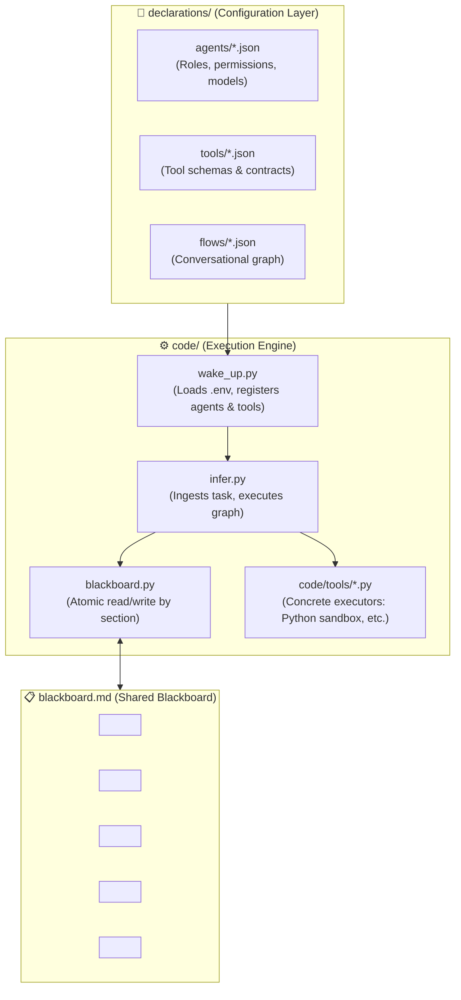

# 🚀 Task-Driven ML Harness

An AI-driven execution harness and multi-agent orchestration framework, engineered and optimized specifically for **autonomous Machine Learning problem solving**.

---

## 💡 Philosophy & Core Design Principles

1. **Engineered for Machine Learning, Not Conversational Chat:**
   The objective is not to engage in freeform human conversation, but to rigorously automate the phases of applied data science: data quality auditing, feature engineering, hypothesis validation, model experimentation, and objective metric-driven decision making.

2. **Blackboard Pattern in Markdown (`blackboard.md`):**
   Rather than circulating long, unstructured conversation transcripts across agents (which causes token blowup and hallucination), agents interact through a **central Markdown blackboard**.
   - Agents read accumulated prior state.
   - Each specialist agent executes its tools and **appends/updates findings, code, and metrics to its designated section**.
   - History is additive and structured; agents do not overwrite upstream progress.

3. **Conversational Flow as a Declarative Graph:**
   Agent interaction is neither chaotic nor unconstrained; it is governed by a **declarative workflow graph** (`declarations/flows/*.json`) that formally defines turn sequence, conditional branching, optimization cycles, and information routing.

4. **Clean Separation Between Declarations and Engine Code:**
   - **`declarations/`**: Houses declarative JSON definitions for agents, tools, and conversational flow graphs. Modifying an agent prompt, tool schema, or graph topology requires zero code refactoring.
   - **`code/`**: Implements operational engine logic (blackboard state manager, execution sandboxes, bootstrap registry, and graph orchestrator).

5. **Terminal Consolidator / Arbiter Agent:**
   The terminal node of the graph is a *Lead Data Scientist* agent operating in **read-only mode**. It inspects the entire accumulated evidence on the blackboard, verifies cross-validation integrity, screens against data leakage and overfitting, and produces the **final decision** (optimal pipeline, reproducible inference script, and technical audit summary).

---

## 🏛️ System Architecture



---

## 📁 Repository Structure

```text
task-driven-harness/
├── declarations/                    # Declarative configuration layer (JSON)
│   ├── agents/                      # Agent specifications (roles, models, permissions)
│   │   └── example_agent.json       # Canonical reference agent declaration
│   ├── tools/                       # Tool schemas and execution contracts
│   │   └── example_tool.json        # Canonical reference tool declaration
│   └── flows/                       # Conversational and control graph definitions
│       └── example_flow.json        # Canonical reference workflow graph
├── code/                            # Executable Python engine layer
│   ├── tools/                       # Concrete tool implementations in Python
│   ├── blackboard.py                # Blackboard read/write manager for blackboard.md
│   ├── wake_up.py                   # Environment bootstrap and agent pool registry
│   └── infer.py                     # Problem ingestion and graph flow orchestrator
├── artifacts/                       # Generated artifacts (models, datasets, scripts)
├── blackboard.md                    # Cumulative shared blackboard in Markdown
├── .env.example                     # Environment variables template (API keys, timeouts)
├── .env                             # Local environment variables file (git-ignored)
├── .gitignore                       # Git ignore definitions
├── requirements.txt                 # Project dependencies
└── README.md                        # Architectural documentation
```

---

## 📐 Declarative Schemas Consolidation

The framework standardizes three declarative specifications under `declarations/`:

### 1. Conversational Flow Graph (`declarations/flows/*.json`)
*Canonical Reference:* [`declarations/flows/example_flow.json`](declarations/flows/example_flow.json)

* **Header & Metadata (`header`):** Specifies graph purpose, version, and architectural traits (`graph_properties`).
* **Cyclic & Bidirectional Dialogue Support:** Edges (`edges`) enable collaborative dialogue channels (`bidirectional: true`), such as iterative cycles between Feature Engineering and Model Exploration.
* **Hierarchical 3-Level Loop Prevention:**
  1. *Global Guard:* `global_guards.global_max_turns` with forced fallback routing to the terminal node upon limit exhaustion.
  2. *Node Guard:* `max_visits` bounding execution turns for individual nodes.
  3. *Cycle Guard (`loop_controls`):* `max_cycle_iterations`, continuation logic (`continue_condition`), exit logic (`exit_condition`), and explicit fallback destination (`fallback_target`).
* **Blackboard Scoping:** Each node explicitly declares `read_sections` and its target `write_section`.

### 2. Agent Declaration (`declarations/agents/*.json`)
*Canonical Reference:* [`declarations/agents/example_agent.json`](declarations/agents/example_agent.json)

* **No Internal Delegation:** The `role.delegation` block is removed. Transitions are 100% governed by the flow graph, preventing redundant calls and conflicting control loops.
* **Role Typology (`role.type`):** `specialist` for execution agents (EDA, Features, Modeling) and `reviewer` for the terminal arbiter/decision maker.
* **Dynamic Prompting (`prompt`):**
  - Mustache templating (`template`).
  - `inputs`: Explicit blackboard sections injected into the agent prompt context.
  - `rules`: Strict data science policies (leakage prevention, empirical execution, deterministic outputs).
* **Strict Output Contract (`output_format`):** Structured JSON schema (`status`, `result`, `warnings`) where `result.markdown_summary` contains clean Markdown formatted for atomic insertion into the blackboard.
* **Inference Settings:** Low temperature (`temperature: 0.1`) and fixed random seeds to ensure analytical rigor and reproducibility.

### 3. Tool Declaration (`declarations/tools/*.json`)
*Canonical Reference:* [`declarations/tools/example_tool.json`](declarations/tools/example_tool.json)

* **Semantic Activation Prompt (`prompt_context`):** High-precision directive instructing the LLM on what the tool does, when to call it, return signatures, and operational boundaries.
* **Input Contract (`input_schema`):** Standard JSON Schema mapped directly to native LLM *Function Calling* APIs.
* **Standardized Output Contract (`output_schema`):**
  - Uniform envelope: `{ "ok": bool, "tool_id": str, "result": { ... }, "error": { "type": str, "message": str } }`.
  - In the event of a failure (syntax error, dependency issue, timeout), returns `ok: false` with detailed tracebacks, enabling agents to **self-debug** without crashing the orchestrator.
* **Runtime Config (`config`):** Sandbox execution constraints (`default_timeout_s`, `max_memory_mb`, `working_directory`).
* **Side-Effect Classification (`side_effects`):** Formal classification (`none | read | write | external`).

---

## 📋 Blackboard Specification (`blackboard.md`)

The shared blackboard uses HTML comment markers to enforce atomic section updates:

```markdown
<!-- SECTION: problem_spec -->
## 1. Problem Specification
(Populated by infer.py with dataset path, target column, metric, constraints)
<!-- END_SECTION: problem_spec -->

<!-- SECTION: eda_insights -->
## 2. Data & EDA Insights
(Committed by eda_agent: missingness, shape, imbalance, leakage risks)
<!-- END_SECTION: eda_insights -->

<!-- SECTION: feature_engineering -->
## 3. Feature Engineering Log
(Committed by feature_agent: transformations, encodings, engineered features)
<!-- END_SECTION: feature_engineering -->

<!-- SECTION: experiment_leaderboard -->
## 4. Experiment Leaderboard & Validation Results
(Committed by model_agent: experiment tracking table, algorithms, CV scores)
<!-- END_SECTION: experiment_leaderboard -->

<!-- SECTION: final_decision -->
## 5. Final Decision & Synthesis
(Committed by consolidator_agent: selected optimal pipeline and reproducible inference script)
<!-- END_SECTION: final_decision -->
```

---

## 🔄 Execution Lifecycle

1. **Credentials & Sandbox Setup (`.env`):**
   Configure API keys (`GEMINI_API_KEY`, etc.) and execution constraints.
2. **System Bootstrap & Registry (`wake_up.py`):**
   Ingests environment variables, validates JSON schemas, and binds tools to executable Python routines.
3. **Task Ingestion & Graph Orchestration (`infer.py`):**
   Initializes `blackboard.md` under `problem_spec`, traverses the conversational graph, and converges on the terminal consolidator's final decision.

---

## 📌 Next Steps

1. Implement the sandbox tool [`code/tools/execute_python.py`](code/tools/execute_python.py).
2. Implement the blackboard state manager [`code/blackboard.py`](code/blackboard.py).
3. Implement the agent and environment bootstrap [`code/wake_up.py`](code/wake_up.py).
4. Implement the graph orchestration engine [`code/infer.py`](code/infer.py).
